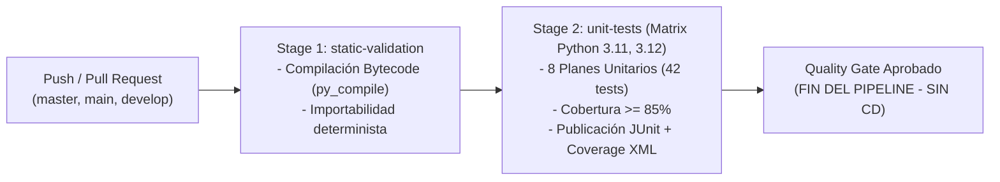
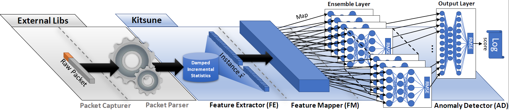

# Kitsune-py: Online Network Intrusion Detection System & CI/CD Testing Pipeline

[](https://github.com/NativelogXD/repositorio-pipeline-kitsune/actions/workflows/ci-unit-tests.yml)
[](tests/unit)
[](tests/unit)
[](requirements.txt)
[](docs/)

> **Proyecto:** Kitsune-py (Online NIDS basado en un ensamble de autoencoders)  
> **Asignatura:** Ingeniería de Software III  
> **Alcance del Pipeline:** Análisis estático, suite completa de 42 pruebas unitarias deterministas y reporte de cobertura con Quality Gate en CI (sin CD de producción).

---

## Estructura del Repositorio

```text
repositorio-pipeline-kitsune/
├── .github/
│   └── workflows/
│       └── ci-unit-tests.yml        # Pipeline CI en GitHub Actions (Matrix Python 3.11/3.12)
├── KitNET/                          # Ensamble de autoencoders y clustering
│   ├── __init__.py
│   ├── KitNET.py                    # Orquestador del ensamble
│   ├── corClust.py                  # Clustering incremental de correlación
│   ├── dA.py                        # Denoising Autoencoder
│   └── utils.py                     # Activaciones, distribuciones y buffer circular
├── docs/                            # Documentación académica y técnica completa
│   ├── 01_ANALISIS_PROYECTO_KITSUNE.md
│   ├── 02_PLAN_GENERAL_PRUEBAS_Y_PIPELINE_CI.md
│   ├── 03_PLANES_ESPECIFICOS_PRUEBAS_UNITARIAS.md
│   ├── kitsune-pruebas.md           # Informe consolidado unificado
│   ├── kitsune-pruebas.docx         # Documento Word formateado para entrega
│   └── planes_unitarios/            # Fichas individuales PU-01 a PU-08
│       ├── PU_01_KitNET_utils.md
│       ├── PU_02_KitNET_dA.md
│       ├── PU_03_KitNET_corClust.md
│       ├── PU_04_KitNET_Orquestador.md
│       ├── PU_05_AfterImage.md
│       ├── PU_06_netStat.md
│       ├── PU_07_FeatureExtractor.md
│       └── PU_08_Kitsune_Facade.md
├── tests/                           # Suite de pruebas unitarias (IEEE 829 / ISO 29119)
│   ├── conftest.py                  # Fixtures deterministas y generador de tráfico TSV
│   └── unit/                        # 42 casos de prueba (PU-01 a PU-08)
│       ├── test_afterimage.py
│       ├── test_corclust.py
│       ├── test_da.py
│       ├── test_feature_extractor.py
│       ├── test_kitnet.py
│       ├── test_kitsune.py
│       ├── test_netstat.py
│       └── test_utils.py
├── AfterImage.py                    # Motor estadístico incremental amortiguado 1D/2D
├── FeatureExtractor.py              # Extractor de paquetes (TSV / Scapy)
├── Kitsune.py                       # Fachada principal del detector NIDS
├── netStat.py                       # Gestor de estadísticas multiperspectiva (100 features)
├── example.py                       # Demostración del flujo con Mirai botnet
├── mirai.zip                        # Captura de paquetes de red para pruebas
├── pytest.ini                       # Configuración de ejecución de pytest
├── requirements.txt                 # Dependencias de producción
├── requirements-dev.txt             # Dependencias de desarrollo y testing
└── setup.py                         # Configuración de empaquetado del módulo
```

---

## Ejecución Local de Pruebas Unitarias

### 1. Instalación de dependencias
```bash
pip install -r requirements-dev.txt
```

### 2. Ejecutar la suite completa de pruebas unitarias (42 casos)
```bash
pytest tests/unit -v
```

### 3. Ejecutar pruebas con reporte de cobertura de código
```bash
pytest tests/unit \
  --cov=KitNET \
  --cov=AfterImage \
  --cov=netStat \
  --cov=FeatureExtractor \
  --cov=Kitsune \
  --cov-report=term-missing \
  --cov-fail-under=85
```

---

## Resumen de Cobertura y Métricas de Calidad

| Módulo Bajo Prueba | Plan Unitario | Sentencias | Cobertura | Casos | Estado |
| :--- | :--- | :---: | :---: | :---: | :---: |
| `KitNET/utils.py` | `PU-01` | 35 | **100%** | 9 | ✅ PASS |
| `KitNET/dA.py` | `PU-02` | 65 | **100%** | 6 | ✅ PASS |
| `KitNET/corClust.py` | `PU-03` | 37 | **100%** | 5 | ✅ PASS |
| `KitNET/KitNET.py` | `PU-04` | 61 | **100%** | 4 | ✅ PASS |
| `AfterImage.py` | `PU-05` | 291 | **98%** | 8 | ✅ PASS |
| `netStat.py` | `PU-06` | 59 | **100%** | 4 | ✅ PASS |
| `FeatureExtractor.py` | `PU-07` | 167 | **83%** | 4 | ✅ PASS |
| `Kitsune.py` | `PU-08` | 11 | **100%** | 2 | ✅ PASS |
| **Total Consolidado** | — | **727** | **95.19%** | **42** | **100% PASS** |

---

## Arquitectura del Pipeline CI en GitHub Actions

El archivo [`.github/workflows/ci-unit-tests.yml`](.github/workflows/ci-unit-tests.yml) implementa dos etapas automatizadas:



---

# Descripción Científica Original de Kitsune

Kitsune es un NIDS no supervisado, online y eficiente basado en redes neuronales profundas (NDSS 2018):
* *Yisroel Mirsky, Tomer Doitshman, Yuval Elovici, and Asaf Shabtai, "Kitsune: An Ensemble of Autoencoders for Online Network Intrusion Detection", Network and Distributed System Security Symposium 2018 (NDSS'18)*

### Arquitectura Técnica de Kitsune:
1. **AfterImage:** Extrae estadísticas temporales amortiguadas de cada canal de red con decaimiento exponencial ($O(1)$ por paquete).
2. **corClust:** Agrupa características correlacionadas mediante clustering jerárquico incremental.
3. **KitNET:** Ensamble de autoencoders pequeños que reconstruyen las características y calculan errores de reconstrucción (RMSE).
4. **Output Layer:** Autoencoder de salida que actúa como mecanismo de votación no lineal para emitir el score de anomalía final.



---

## Licencia y Citación

* Licencia MIT - consultar el archivo [LICENSE](LICENSE).
* Para citar el trabajo académico:
  ```bibtex
  @inproceedings{mirsky2018kitsune,
    title={Kitsune: An Ensemble of Autoencoders for Online Network Intrusion Detection},
    author={Mirsky, Yisroel and Doitshman, Tomer and Elovici, Yuval and Shabtai, Asaf},
    booktitle={Network and Distributed System Security Symposium (NDSS)},
    year={2018}
  }
  ```
