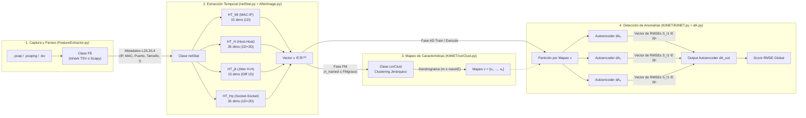

# Análisis Arquitectónico, Algorítmico y de Calidad de Software: Proyecto Kitsune-py

> **Repositorio Analizado:** `https://github.com/ymirsky/Kitsune-py`  
> **Referencia Científica:** Yisroel Mirsky, Tomer Doitshman, Yuval Elovici, Asaf Shabtai, *"Kitsune: An Ensemble of Autoencoders for Online Network Intrusion Detection"*, NDSS 2018.  
> **Ubicación Local del Repositorio:** `C:\Users\xiao\Documents\universidad\ing softwqqare 3\repo-kitsune`

---

## 1. Intuición Técnica antes de la Formalidad

Los Sistemas de Detección de Intrusiones en Red (NIDS) basados en Aprendizaje Profundo suelen enfrentar tres cuellos de botella estructurales cuando se intentan ejecutar en equipos de borde (*routers*, *gateways* IoT o sondas embebidas):

1. **Restricción de Memoria y Cómputo en Streaming:** Un flujo de red de alta velocidad no puede almacenarse en RAM para entrenar por lotes (*batch training*). Además, entrenar una única red neuronal densa sobre $n \ge 100$ características tiene un costo cuadrático $O(n^2)$ por capa, prohibitivo en CPU sin aceleración GPU.
2. **Ausencia de Etiquetas (Aprendizaje No Supervisado Online):** En despliegues reales no existen conjuntos etiquetados de ataques *zero-day*. El detector debe aprender la línea base de tráfico benigno de forma incremental y autónoma (*plug-and-play*).
3. **Contexto Temporal de Flujos Asíncronos:** Un paquete aislado carece de contexto suficiente para distinguir un escaneo sigiloso o una botnet (ej. *Mirai*) de un flujo legítimo; sin embargo, mantener ventanas deslizantes exactas de paquetes pasados requeriría memoria proporcional al volumen de tráfico.

### ¿Cómo resuelve Kitsune estos tres problemas?

* **Memoria Temporal Amortiguada (`AfterImage`):** En lugar de guardar históricos de paquetes, mantiene **estadísticas incrementales con decaimiento exponencial** ($2^{-\lambda \Delta t}$) sobre múltiples escalas temporales $\lambda \in \{5, 3, 1, 0.1, 0.01\}$. Cada flujo solo necesita almacenar tres acumuladores escalares ($CF_1, CF_2, w$), logrando actualización en tiempo constante $O(1)$ por paquete.
* **Divide y Vencerás Neuronal (`corClust` + `KitNET`):** En lugar de alimentar las $n = 100$ características a un único autoencoder gigante (cuyo paso de entrenamiento costaría $O(n^2) = 10,000$ operaciones por capa), Kitsune agrupa las características altamente correlacionadas en $k$ subconjuntos pequeños de tamaño máximo $m$ (por defecto $m = 10$). Entrenar $k \approx 10$ autoencoders pequeños cuesta $O(k \cdot m^2) \approx 1,000$ operaciones, reduciendo un orden de magnitud el costo computacional.
* **Votación No Lineal Jerárquica (`Output Layer`):** Cada autoencoder del ensamble emite su error de reconstrucción (RMSE). Un autoencoder final de salida recibe el vector de errores del ensamble y aprende la distribución conjunta normal de dichos errores, emitiendo el puntaje de anomalía global.

---

## 2. Arquitectura del Sistema y Flujo de Datos

El sistema opera como una tubería (*pipeline*) síncrona paquete a paquete gobernada por la fachada [`Kitsune`](../Kitsune.py):

---

## 3. Desglose de Módulos y Formulación Matemática

### 3.1. Motor Estadístico Incremental: [`AfterImage.py`](../AfterImage.py)
Implementa tres clases fundamentales:

1. **`incStat` (Estadísticas Univariadas 1D):**
   Para un flujo identificado por `ID` y factor de decaimiento $\lambda > 0$, cuando llega una observación $(v, t_{\text{now}})$, primero se aplica el factor de amortiguamiento exponencial respecto al último instante registrado $t_{\text{last}}$ ($\Delta t = t_{\text{now}} - t_{\text{last}} \ge 0$):
   $$\gamma = 2^{-\lambda \Delta t}$$
   Los acumuladores suficientes (*Cluster Features*) se actualizan como:
   $$CF_1 \leftarrow \gamma \cdot CF_1 + v, \qquad CF_2 \leftarrow \gamma \cdot CF_2 + v^2, \qquad w \leftarrow \gamma \cdot w + 1$$
   A partir de $(w, CF_1, CF_2)$ se derivan en $O(1)$:
   $$\mu = \frac{CF_1}{w}, \qquad \sigma^2 = \left|\frac{CF_2}{w} - \mu^2\right|, \qquad \sigma = \sqrt{\sigma^2}$$
   Si `isTypeDiff=True` (usado para el *Jitter*), el valor insertado se reemplaza por $v = \max(0, t_{\text{now}} - t_{\text{last}})$.

2. **`incStat_cov` (Estadísticas Covariantes Bivariadas 2D):**
   Vincula dos flujos univariados $(S_1, S_2)$ manteniendo el acumulador de productos de residuos $CF_3$, el peso conjunto $w_3$ y el último residuo de cada flujo $r_i = v_i - \mu_i$:
   $$CF_3 \leftarrow 2^{-\lambda \Delta t} CF_3 + (v_i - \mu_i) \cdot r_{\neg i}, \qquad w_3 \leftarrow 2^{-\lambda \Delta t} w_3 + 1$$
   Calcula cuatro métricas conjuntas 2D entre ambos flujos:
   * **Radio (`radius`):** $R(S_1, S_2) = \sqrt{(\sigma_1^2)^2 + (\sigma_2^2)^2}$ en `AfterImage.py` (o $\sqrt{\sigma_1^2 + \sigma_2^2}$ en `get_nD_Stats`).
   * **Magnitud (`magnitude`):** $M(S_1, S_2) = \sqrt{\mu_1^2 + \mu_2^2}$.
   * **Covarianza aproximada (`cov`):** $\text{Cov}(S_1, S_2) = \frac{CF_3}{w_3}$.
   * **Coeficiente de Correlación de Pearson (`pcc`):** $\rho(S_1, S_2) = \frac{\text{Cov}(S_1, S_2)}{\sigma_1 \sigma_2}$ (o $0$ si $\sigma_1 \sigma_2 = 0$).

3. **`incStatDB` (Base de Datos Hash de Flujos):**
   Gestiona un diccionario `HT` indexado por `f"{ID}_{Lambda}"` con cota superior `limit`. Si el número de claves supera `limit`, lanza `LookupError`. Incluye el método `cleanOutOldRecords(cutoffWeight, curTime)` para podar flujos inactivos cuyo peso amortiguado $w \le \text{cutoffWeight}$.

---

### 3.2. Gestor de Estadísticas de Red: [`netStat.py`](../netStat.py)
Instancia cuatro bases `incStatDB` evaluadas sobre 5 factores de decaimiento $\Lambda = [5, 3, 1, 0.1, 0.01]$:

| Tabla Hash | Clave de Agregación | Tipo de Estadística | Métricas por $\lambda$ | Total ($\times 5\ \lambda$) |
| :--- | :--- | :--- | :---: | :---: |
| `HT_MI` | `srcMAC + srcIP` | 1D (`w, mean, var`) | 3 | **15** |
| `HT_H` | `srcIP` $\leftrightarrow$ `dstIP` | 1D + 2D (`w, mean, var, rad, mag, cov, pcc`) | 7 | **35** |
| `HT_jit` | `srcIP + dstIP` (`isTypeDiff=True`) | 1D Jitter (`w, mean, var`) | 3 | **15** |
| `HT_Hp` | `srcIP+srcPort` $\leftrightarrow$ `dstIP+dstPort` (o MACs en ARP) | 1D + 2D (`w, mean, var, rad, mag, cov, pcc`) | 7 | **35** |
| **Total** | — | Concatenación `np.concatenate` | **20** | **100 features** |

---

### 3.3. Extractor de Paquetes: [`FeatureExtractor.py`](../FeatureExtractor.py)
La clase `FE` abstrae el origen de datos de tráfico de red:
* **Modo TSV (Rápido / Streaming $O(1)$ en RAM):** Si el archivo de entrada es `.tsv` o si se encuentra `tshark` instalado para convertir `.pcap`/`.pcapng` a `.tsv`, utiliza un iterador `csv.reader(..., delimiter='\t')` sobre 19 campos de protocolo.
* **Modo Scapy (Fallback / Carga $O(M)$ en RAM):** Si el archivo es `.pcap`/`.pcapng` y no existe `tshark`, invoca `scapy.all.rdpcap(self.path)` y extrae capas `IP`, `IPv6`, `TCP`, `UDP`, `ARP`, `ICMP` o direcciones MAC de capa 2.

---

### 3.4. Agrupamiento Incremental de Características: [`KitNET/corClust.py`](../KitNET/corClust.py)
Durante la fase de mapeo (`FM_grace_period`), recibe vectores $x \in \mathbb{R}^n$ y actualiza en forma vectorizada:
$$N \leftarrow N + 1, \quad c \leftarrow c + x, \quad r_t = x - \frac{c}{N}, \quad c_r \leftarrow c_r + r_t, \quad c_{rs} \leftarrow c_{rs} + r_t^2, \quad C \leftarrow C + r_t r_t^\top$$
Al finalizar el periodo de gracia, calcula la matriz de distancia de correlación:
$$D = 1 - \frac{C}{\sqrt{c_{rs}} \otimes \sqrt{c_{rs}}}, \qquad D_{ij} \leftarrow \max(0, D_{ij})$$
Aplica `scipy.cluster.hierarchy.linkage` sobre el triángulo superior de $D$ y divide recursivamente el árbol (`__breakClust__`) hasta que todo subárbol tenga a lo sumo `maxClust` ($m$) hojas.

---

### 3.5. Ensamble de Autoencoders: [`KitNET/KitNET.py`](../KitNET/KitNET.py) y [`KitNET/dA.py`](../KitNET/dA.py)
Cada autoencoder `dA` con dimensión visible $d_v \le m$ y dimensión oculta $d_h = \lceil d_v \cdot \text{hiddenRatio} \rceil$:
1. Actualiza los extremos históricos $\text{norm\_min}, \text{norm\_max} \in \mathbb{R}^{d_v}$ y normaliza la entrada en $[0, 1]$:
   $$\hat{x} = \frac{x - \text{norm\_min}}{\text{norm\_max} - \text{norm\_min} + 10^{-16}}$$
2. Codifica y decodifica con pesos atados ($W' = W^\top$):
   $$y = \sigma(\tilde{x} W + b_h), \qquad z = \sigma(y W^\top + b_v)$$
3. Durante el entrenamiento (`train`), actualiza pesos mediante SGD con tasa de aprendizaje $\eta$ (`lr`):
   $$L_{h2} = \hat{x} - z, \qquad L_{h1} = (L_{h2} W) \odot y \odot (1 - y)$$
   $$W \leftarrow W + \eta (\tilde{x}^\top L_{h1} + L_{h2}^\top y), \qquad b_h \leftarrow b_h + \eta L_{h1}, \qquad b_v \leftarrow b_v + \eta L_{h2}$$
4. Retorna el error de reconstrucción $\text{RMSE} = \sqrt{\frac{1}{d_v} \sum_{j=1}^{d_v} (\hat{x}_j - z_j)^2}$.

---

## 4. Evaluación de Complejidad Temporal y Espacial

Siguiendo los principios de eficiencia algorítmica, se evalúa el costo por paquete procesado (donde $n = 100$ es el número de características, $|\Lambda| = 5$ el número de ventanas, $m = 10$ el tamaño máximo de autoencoder, $k \ge \lceil n/m \rceil$ el número de autoencoders del ensamble y $M$ el total de paquetes del archivo):

| Subsistema / Método | Complejidad Temporal (por paquete) | Complejidad Espacial (RAM) | Observaciones de Eficiencia y Vectorización |
| :--- | :---: | :---: | :--- |
| **`FE.get_next_vector()` (Modo TSV)** | $O(1)$ amortizado | $O(1)$ | Streaming puro mediante `csv.reader`; nota: el conteo inicial de líneas recorre el archivo en $O(M)$ I/O. |
| **`FE.get_next_vector()` (Modo Scapy)** | $O(1)$ tras carga inicial $O(M)$ | $O(M)$ | `rdpcap()` carga todos los paquetes en memoria; cuello de botella en capturas grandes. |
| **`netStat.updateGetStats()`** | $O(|\Lambda|) = O(1)$ | $O(|HT_{\text{activos}}| \cdot |\Lambda|)$ | Búsqueda hash $O(1)$ en `incStatDB` y actualización de escalares para 5 lambdas. |
| **`corClust.update(x)`** | $O(n^2)$ | $O(n^2)$ | Totalmente vectorizado con `np.outer(c_rt, c_rt)` sobre $n=100$. |
| **`corClust.cluster(m)`** | $O(n^2 \log n)$ (una sola vez) | $O(n^2)$ | Se ejecuta únicamente en la transición `n_trained == FM_grace_period`. |
| **`KitNET.train(x)` / `execute(x)`** | $O\left(\sum_{i=1}^k d_{v,i}^2 + k^2\right) \le O(n \cdot m + k^2)$ | $O(n \cdot m + k^2)$ | Para $n=100, m=10$, reduce el costo de $O(n^2)=10,000$ a $\approx 1,100$ operaciones matriciales. |

---

## 5. Hallazgos de la Auditoría Técnica y Defectos Latentes Corregidos

Durante la inspección estática del código original de `ymirsky/Kitsune-py` (escrito originalmente para Python 3.6 y NumPy 1.13 en 2018), se identificaron y documentaron los siguientes hallazgos críticos:

1. **Discrepancia Dimensional Documentada (100 vs 115 características):**
   En `example.py` se menciona un dataset de $n=115$ dimensiones. Sin embargo, en [`netStat.py`](../netStat.py#L75-L77), el bloque `Hstat` (15 características univariadas de ancho de banda por IP origen) se encuentra comentado en el repositorio oficial. Como resultado, el vector real generado por `netStat.updateGetStats()` y `getNetStatHeaders()` posee exactamente **$n = 100$ dimensiones** ($15 + 35 + 15 + 35$).
2. **Incompatibilidad con NumPy $\ge 2.0$ (`np.Inf` / `numpy.Inf`):**
   El alias `np.Inf` fue eliminado en NumPy 2.0. Se actualizó quirúrgicamente a `np.inf` / `numpy.inf` en `AfterImage.py`, `KitNET/dA.py` y `example.py`.
3. **Defecto Tipográfico `np.na` en `AfterImage.py` (Líneas 314 y 326):**
   Los métodos `incStatDB.get_1D_Stats()` y `get_2D_Stats()` devolvían `[np.na]*3` y `[np.na]*2` cuando un flujo no existía en la tabla hash, provocando un `AttributeError: module 'numpy' has no attribute 'na'`. Se corrigió a `[np.nan]`.
4. **Defecto Estructural en `incStatDB.cleanOutOldRecords()` (`AfterImage.py` Líneas 428-441):**
   El método intentaba indexar cada valor del diccionario como una lista (`tup[1][0].getMaxW(curTime)`), provocando `TypeError: 'incStat' object is not subscriptable`. Se corrigió aplicando `processDecay(curTime)` directamente sobre las instancias `incStat` y ordenando por su peso `incS.w`.
5. **Validación Vectorial de `Lambdas` en `netStat.__init__()`:**
   La condición `if np.isnan(Lambdas):` lanzaba `ValueError: The truth value of an array with more than one element is ambiguous` cuando se suministraba una lista personalizada de factores $\Lambda$. Se corrigió mediante `if np.all(np.isnan(Lambdas)):`.
6. **Comportamiento de Frontera (*Off-by-One*) en `KitNET.py`:**
   En `KitNET.train(x)`, la fase de mapeo de características se ejecuta mientras `self.n_trained <= self.FM_grace_period` (lo que consume `FM_grace_period + 1` paquetes, desde `0` hasta `FM_grace_period` inclusive). En consecuencia, el sistema requiere exactamente `FM_grace_period + AD_grace_period + 1` llamadas a `process(x)` antes de que `self.n_trained > self.FM_grace_period + self.AD_grace_period` active la fase de ejecución `execute(x)`. Este invariante ha sido formalizado y verificado en los planes de pruebas unitarias `PU-KITNET` y `PU-KITSUNE`.

