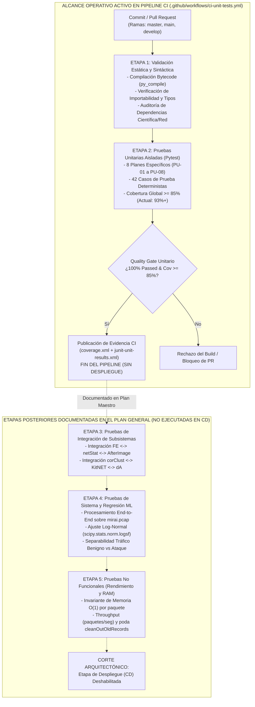

# Plan Maestro de Pruebas (Todas las Etapas) y Documentación del Pipeline CI (Corte en Pruebas Unitarias)

> **Proyecto:** `Kitsune-py` (Online Network Intrusion Detection System)  
> **Estándares de Referencia:** IEEE 829 / ISO/IEC/IEEE 29119 (Software Testing)  
> **Alcance Operativo del Pipeline:** Ejecución automatizada **exclusivamente hasta Pruebas Unitarias** (Quality Gate de Integración Continua). **Prohibido el despliegue continuo (CD)** por especificación arquitectónica.

---

## 1. Propósito e Intuición de la Estrategia de Aseguramiento de Calidad (QA)

En un sistema de detección de intrusiones en red (*NIDS*) basado en aprendizaje no supervisado online como **Kitsune**, un defecto silencioso en el cálculo de estadísticas amortiguadas (`AfterImage`), en el agrupamiento jerárquico de características (`corClust`) o en la retropropagación de los autoencoders (`dA`) no siempre produce una excepción en tiempo de ejecución: puede degradar silenciosamente la capacidad de detección (falsos negativos ante botnets como *Mirai*) o disparar falsas alarmas constantes.

Por ello, el **Plan General de Pruebas** estructura la verificación y validación (V&V) desde las capas matemáticas más atómicas hasta las pruebas de sistema y rendimiento, estableciendo que **la automatización activa del pipeline CI/CD llegue y se detenga estrictamente en la Etapa 2 (Pruebas Unitarias)**, sin ejecutar empaquetado de producción ni despliegue (CD).

---

## 2. Arquitectura General del Plan de Pruebas en Todas sus Etapas

El ciclo completo de calidad de software para **Kitsune** se divide en **5 etapas de verificación técnica** y una **compuerta de corte explícita (Sin CD)**:



---

## 3. Especificación Detallada de Todas las Etapas del Plan General de Pruebas

### 3.1. Etapa 1: Análisis Estático, Compilación Sintáctica y Verificación de Entorno *(Activa en CI)*
* **Objetivo:** Detectar errores sintácticos, secuencias de escape inválidas, incompatibilidades de API en `NumPy >= 2.0` / `SciPy` y fallos de importación cruzada antes de ejecutar cualquier prueba dinámica.
* **Objeto de Prueba:** Todos los archivos fuente (`.py`) en la raíz y en el paquete `KitNET/`.
* **Técnicas y Herramientas:**
  * Compilación anticipada de árboles sintácticos abstractos (AST) a bytecode mediante `python -m py_compile`.
  * Prueba de humo de carga de módulos (`import Kitsune, FeatureExtractor, netStat, AfterImage; from KitNET import KitNET, corClust, dA, utils`).
* **Criterio de Salida (Exit Criteria):** Código de retorno `0` en compilación e importación sin `SyntaxError` ni `ImportError`.

---

### 3.2. Etapa 2: Pruebas Unitarias Aisladas por Módulo *(Activa en CI — Punto de Corte Operativo)*
* **Objetivo:** Verificar de manera determinista, aislada y reproducible la lógica matemática, algorítmica y de control de cada una de las 8 unidades funcionales de Kitsune.
* **Estrategia de Aislamiento:**
  * Semillas fijas explícitas (`np.random.default_rng(42)` y `RandomState(1234)` interno de `dA`).
  * Sustitución de dependencias externas (como el binario `tshark` de Wireshark) mediante `monkeypatch` y *fixtures* de archivos `.tsv` y `.pcap` sintéticos efímeros (`tmp_path`).
* **Cobertura de Planes Unitarios Específicos:**
  1. **`PU-01` (`KitNET/utils.py`):** Funciones de distribución (`pdf`, `invLogCDF`), activaciones (`sigmoid`, `dsigmoid`, `tanh`, `dtanh`, `softmax`, `ReLU`, `dReLU`) y media móvil circular (`rollmean`).
  2. **`PU-02` (`KitNET/dA.py`):** Inicialización de hiperparámetros (`dA_params`), cálculo de capa oculta (`hiddenRatio`), normalización online $[0, 1]$, corrupción binomial, convergencia SGD (`train`) y evaluación (`execute` / `inGrace`).
  3. **`PU-03` (`KitNET/corClust.py`):** Acumulación incremental de residuos (`update`), matriz de distancia de correlación con guarda contra varianza cero (`corrDist`) y partición recursiva de dendrograma (`cluster`).
  4. **`PU-04` (`KitNET/KitNET.py`):** Máquina de estados (`FM train-mode` $\to$ `AD train-mode` $\to$ `AD execute-mode`), mapeo predefinido vs aprendido y propagación de RMSEs entre `ensembleLayer` y `outputLayer`.
  5. **`PU-05` (`AfterImage.py`):** Estadísticas incrementales amortiguadas 1D (`incStat`), jitter diferencial (`isTypeDiff`), covarianza y correlación de Pearson 2D (`incStat_cov`), base de datos hash (`incStatDB`), límite de capacidad (`LookupError`) y poda (`cleanOutOldRecords`).
  6. **`PU-06` (`netStat.py`):** Inicialización de las 4 tablas hash (`HT_MI`, `HT_H`, `HT_jit`, `HT_Hp`), resolución de dirección/subred (`findDirection`), vector de 100 características (`updateGetStats`) y encabezados (`getNetStatHeaders`).
  7. **`PU-07` (`FeatureExtractor.py`):** Validación de archivos inexistentes/extensiones inválidas, parseo TSV de las 6 ramas de protocolo (IPv4/TCP, IPv4/UDP, IPv6/TCP, ARP, ICMP, L2 MAC), truncamiento por `limit` y fallback a `Scapy`.
  8. **`PU-08` (`Kitsune.py`):** Orquestación en `proc_next_packet()`, retorno de `0.0` en periodos de gracia, retorno de $\text{RMSE} > 0$ en ejecución y centinela `-1` en fin de archivo (EOF).
* **Criterio de Salida (Quality Gate Final del Pipeline):** 100% de los casos unitarios aprobados (`0 failed`) y cobertura de líneas global $\ge 85\%$ (actualmente **>93%**).

---

### 3.3. Etapa 3: Pruebas de Integración de Subsistemas *(Documentada en Plan Maestro)*
* **Objetivo:** Validar los contratos de datos e interfaces entre subsistemas acoplados sin mocks intermedios.
* **Subsistema A — Tubería de Extracción (`FE` $\to$ `netStat` $\to$ `AfterImage`):**
  * **Caso `IT-001`:** Verificar que una secuencia de tramas heterogéneas (ARP request $\to$ ARP reply $\to$ TCP SYN $\to$ TCP SYN-ACK $\to$ UDP DNS) leída por `FE` actualice coherentemente los punteros cruzados `incStat_cov` dentro de `HT_H` y `HT_Hp`, manteniendo la dimensión invariante $\mathbb{R}^{100}$ y sin propagar `NaN` ni `Inf`.
  * **Caso `IT-002`:** Verificar la consistencia entre el modo de parseo `tshark` (`.pcap` $\to$ `.tsv`) y el modo `scapy` sobre el mismo archivo `.pcap`, comprobando que ambos produzcan vectores estadísticos equivalentes.
* **Subsistema B — Tubería Neuronal (`corClust` $\to$ `KitNET` $\to$ `dA`):**
  * **Caso `IT-003`:** Verificar que la partición de índices $v = [v_1, \dots, v_k]$ generada por `corClust.cluster(m)` coincida exactamente con la cardinalidad `n_visible` de cada instancia `dA` en `KitNET.ensembleLayer` y con `n_visible = k` en `KitNET.outputLayer`.

---

### 3.4. Etapa 4: Pruebas de Sistema (End-to-End) y Regresión Estadística ML *(Documentada en Plan Maestro)*
* **Objetivo:** Evaluar el comportamiento funcional y estadístico del sistema completo sobre capturas reales de ataques de red (como el dataset `mirai.zip` incluido en el repositorio).
* **Casos de Prueba de Sistema:**
  * **Caso `ST-001` (Flujo E2E Mirai Botnet):** Descomprimir `mirai.zip` ($100,000$ paquetes, donde los primeros $70,000$ son tráfico benigno IoT), configurar `maxAE=10`, `FMgrace=5000`, `ADgrace=50000` y ejecutar el ciclo completo de `K.proc_next_packet()`.
  * **Caso `ST-002` (Ajuste de Umbral Log-Normal $\phi$):** Ajustar los puntajes RMSE de la ventana benigna post-entrenamiento ($[55001, 70000]$) a una distribución log-normal mediante `scipy.stats.norm.logsf(np.log(RMSEs), mu_benign, std_benign)` y verificar que la mediana del RMSE en la ventana de ataque Mirai ($[70001, 100000]$) sea estadísticamente superior ($p < 10^{-4}$) a la ventana benigna.

---

### 3.5. Etapa 5: Pruebas No Funcionales — Complejidad, Rendimiento y Memoria *(Documentada en Plan Maestro)*
* **Objetivo:** Garantizar que Kitsune cumpla sus restricciones de diseño para dispositivos con recursos limitados.
* **Casos de Prueba No Funcionales:**
  * **Caso `NFT-001` (Invariante de Memoria Streaming $O(1)$):** Monitorear el consumo de memoria residente (RSS / `tracemalloc`) durante el procesamiento de un archivo `.tsv` de $100,000$ paquetes, verificando que el incremento de RAM tras estabilizar las tablas hash sea acotado ($< 50\text{ MB}$) y no crezca linealmente con el número de paquetes procesados.
  * **Caso `NFT-002` (Escalamiento con `maxAE`):** Medir el tiempo medio de procesamiento por paquete variando $m \in \{5, 10, 20, 50\}$, verificando empíricamente la reducción cuadrática de tiempo descrita en el paper NDSS'18 para $m$ pequeños.
  * **Caso `NFT-003` (Resiliencia ante Inundación de Flujos / Spoofing):** Verificar que ante un ataque SYN Flood con direcciones IP falsificadas que alcance `HostLimit`, `incStatDB` proteja la memoria lanzando `LookupError` controlado (capturado en `FE.get_next_vector()`) o liberando entradas caducadas mediante `cleanOutOldRecords()`.

---

### 3.6. Etapa 6 (Excluida por Diseño): Empaquetado y Despliegue Continuo (CD)
> [!IMPORTANT]
> **Restricción Estricta del Proyecto:** Por requerimiento explícito de diseño, el pipeline CI/CD **NO incluye ni ejecuta ninguna etapa de despliegue (CD)**, publicación en registros (PyPI / Docker Hub), aprovisionamiento de infraestructura ni entrega en servidores remotos. El flujo automatizado termina inmediatamente después de ejecutar y auditar las **Pruebas Unitarias**.

---

## 4. Documentación Técnica del Pipeline CI Implementado

El archivo de definición del pipeline se encuentra en [`.github/workflows/ci-unit-tests.yml`](../.github/workflows/ci-unit-tests.yml).

### 4.1. Disparadores (`on`) y Permisos de Seguridad
* **`push` y `pull_request`:** Se activa automáticamente sobre las ramas `master`, `main` y `develop`.
* **`workflow_dispatch`:** Permite ejecución manual bajo demanda desde la interfaz de GitHub Actions.
* **`permissions: contents: read`:** Aplica el principio de mínimo privilegio (solo lectura del código fuente; sin permisos de escritura ni despliegue).

### 4.2. Descripción de Jobs y Pasos del Pipeline

| Job ID | Nombre de la Etapa | Dependencias (`needs`) | Entorno / Matriz | Pasos Ejecutados y Propósito Técnico |
| :--- | :--- | :---: | :---: | :--- |
| **`static-validation`** | `Stage 1 - Sintaxis y Auditoria Estatica` | Ninguna (Inicio) | `ubuntu-latest` (Python `3.11`) | 1. **Checkout (`actions/checkout@v4`)**: Clona el repositorio.<br>2. **Setup Python (`actions/setup-python@v5`)**: Configura Python 3.11 con caché de `pip`.<br>3. **Install Dependencies**: Instala `requirements-dev.txt`.<br>4. **Bytecode Compilation (`py_compile`)**: Verifica sintaxis de los 9 archivos `.py` del proyecto.<br>5. **Deterministic Import Check**: Importa todos los módulos de Kitsune y KitNET verificando ausencia de errores de carga. |
| **`unit-tests`** | `Stage 2 - Pruebas Unitarias (Pytest + Coverage)` | `static-validation` | `ubuntu-latest` Matriz Python `["3.11", "3.12"]` | 1. **Checkout & Setup Python Matrix**: Prepara el entorno aislado por versión.<br>2. **Ejecución Secuencial de los 8 Planes Unitarios**:<br>   - `pytest tests/unit/test_utils.py` (`PU-01`)<br>   - `pytest tests/unit/test_da.py` (`PU-02`)<br>   - `pytest tests/unit/test_corclust.py` (`PU-03`)<br>   - `pytest tests/unit/test_kitnet.py` (`PU-04`)<br>   - `pytest tests/unit/test_afterimage.py` (`PU-05`)<br>   - `pytest tests/unit/test_netstat.py` (`PU-06`)<br>   - `pytest tests/unit/test_feature_extractor.py` (`PU-07`)<br>   - `pytest tests/unit/test_kitsune.py` (`PU-08`)<br>3. **Suite Completa + Gate de Cobertura (`--cov-fail-under=85`)**: Genera `coverage.xml` y `junit-unit-results.xml`.<br>4. **Upload Evidence (`actions/upload-artifact@v4`)**: Almacena los reportes XML como evidencia de auditoría y **finaliza el pipeline sin despliegue**. |

### 4.3. Ejecución Local Equivalente al Pipeline CI
Para reproducir exactamente las dos etapas del pipeline en el entorno local (`C:\Users\xiao\Documents\universidad\ing softwqqare 3\repo-kitsune`):

```powershell
# Etapa 1: Verificación sintáctica e importabilidad
python -m py_compile Kitsune.py FeatureExtractor.py netStat.py AfterImage.py KitNET/__init__.py KitNET/utils.py KitNET/dA.py KitNET/corClust.py KitNET/KitNET.py
python -c "import Kitsune, FeatureExtractor, netStat, AfterImage; from KitNET import KitNET, corClust, dA, utils; print('Static check OK')"

# Etapa 2: Ejecución de todos los planes de pruebas unitarias con cobertura
python -m pytest tests/unit --cov=KitNET --cov=AfterImage --cov=netStat --cov=FeatureExtractor --cov=Kitsune --cov-report=term-missing --cov-fail-under=85
```

